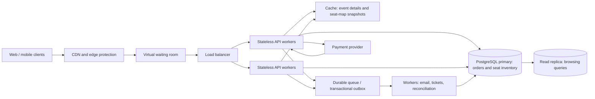

# TicketHub: ticketing system design

TicketHub sells reserved-seat tickets for concerts and other events. PostgreSQL is the authoritative store for seat availability and orders; caches and queues help handle demand but never decide whether a seat is available.

## 1. Requirements

### Functional requirements

- Allow users to register, sign in, and manage their account.
- Let anyone browse and search published events, view event details, and see a seat map with current availability and prices.
- Let an authenticated user temporarily hold available seats, with a clear expiry time and a limit on seats per order.
- Accept payment for a valid hold and issue tickets only after payment succeeds.
- Let a user view their orders and retrieve their tickets.
- Release seats when a hold expires, payment fails, or an order is cancelled; support refunds and cancellation according to the event's policy.
- Send confirmation and event-update notifications, and provide support staff with auditable order and inventory records.

### Non-functional requirements

- **Correctness:** A seat can belong to at most one active hold and one completed sale. Seat allocation and order state changes must be transactional and durable. Payment retries and callbacks must be idempotent.
- **Fairness:** For high-demand sales, admit customers through a waiting room and serve them in arrival order (with a published, randomized queue position for customers who arrive before the announced sale opens). Apply the same rules to everyone, cap per-user purchases, rate-limit automation, and show queue progress and hold-expiry rules.
- **Speed:** Target p95 under 300 ms for ordinary event browsing and seat-map reads, and under 1 second for hold requests while the user is admitted. During a sale, show queue status promptly rather than letting all shoppers overload the inventory database.
- **Availability and resilience:** Target 99.9% monthly availability outside announced maintenance. Run application instances across zones, use managed database failover and backups, and degrade gracefully if non-critical notifications or analytics are delayed.
- **Security and privacy:** Use HTTPS, secure authentication, least-privilege service credentials, payment-provider tokenization (do not store card numbers), and access checks on every order and ticket request.
- **Scalability and observability:** Scale stateless API workers horizontally; monitor request latency, queue wait, hold conflicts/expiry, database contention, payment outcomes, and inventory reconciliation. Load-test before major sales.

## 2. Capacity estimates

Given: 2 million registered users; 50,000 daily visitors, each viewing 10 pages; 5,000 tickets sold on a normal day; and 200,000 people trying to buy 20,000 seats within the first 10 minutes of a popular sale.

### Normal day

| Measure | Estimate and assumption |
|---|---:|
| Page views | 50,000 × 10 = **500,000 page views/day** |
| Average page/API read rate | Assuming one dynamic API read per page: 500,000 ÷ 86,400 = **about 5.8 requests/second on average** |
| Ticket sales | **5,000 tickets/day**, or about **0.058 tickets/second on average** |
| Registered accounts | **2 million**; this is account scale, not concurrent traffic |

Actual pages may make multiple API calls, and activity is not uniform through the day. As an initial planning allowance, provision for a 5× ordinary peak (about 29 read requests/second under the one-request-per-page assumption), then replace that estimate with measured traffic.

### Popular concert sale

| Measure | Estimate and assumption |
|---|---:|
| People arriving in the sale window | 200,000 ÷ 600 seconds = **about 333 people/second** over 10 minutes |
| Seat supply | **20,000 seats**; at most 20,000 successful seat allocations |
| Conversion ceiling | 20,000 ÷ 200,000 = **10%** of the attempted buyers can get a seat |
| Estimated dynamic API demand | If each person makes three uncached calls (event/queue, seat map, hold), 200,000 × 3 ÷ 600 = **about 1,000 requests/second** averaged over the 10-minute window |

The sale-window average of 333 arrivals/second is roughly **57×** the normal average of 5.8 page/API reads per second; the illustrative 1,000 API requests/second is roughly **172×** that baseline. The real opening burst may be higher than the 10-minute average. A virtual waiting room paces admitted buyers to measured database capacity; CDN-cached event assets, bounded retries with jitter, and load testing protect the service. Inventory writes remain serialized by seat at the database, not by the cache.

## 3. API

Base URL: `https://api.tickethub.example/v1`. JSON is used for request and response bodies. Authenticated endpoints use a bearer token. State-changing requests accept an `Idempotency-Key` so a network retry does not create another hold, order, or payment. Errors use a consistent JSON body with a stable code and request ID.

| Method and path | Purpose | Success |
|---|---|---:|
| `GET /events?query=&cursor=&limit=` | Browse/search published events; paginated and cacheable. | `200` |
| `GET /events/{eventId}` | View event details, sale status, venue, and policies. | `200` |
| `GET /events/{eventId}/seats` | View seat map and availability; may be briefly stale and is not a promise that a seat can still be held. | `200` |
| `POST /events/{eventId}/holds` | Hold one or more seat IDs for the signed-in user; returns a hold ID and expiry. Conflicts if any requested seat cannot be claimed. | `201` |
| `POST /orders/{orderId}/payment` | Start or confirm payment for an order backed by a live hold, using the payment provider's tokenized payment method. | `202` |
| `GET /me/tickets?cursor=` | View the authenticated user's paid tickets and ticket credentials. | `200` |

Example hold request:

```json
{
  "seatIds": ["seat-104", "seat-105"]
}
```

Example response (`201 Created`):

```json
{
  "holdId": "hold-7b86",
  "orderId": "order-31c2",
  "expiresAt": "2026-10-18T16:05:00Z",
  "seats": [
    { "seatId": "seat-104", "price": 85.00, "currency": "USD" },
    { "seatId": "seat-105", "price": 85.00, "currency": "USD" }
  ]
}
```

Use `409 Conflict` when a seat is no longer available, `410 Gone` for an expired hold, `429 Too Many Requests` with `Retry-After` for rate limits, and `401/403` for authentication/authorization failures. A failed or pending payment must not be reported as a completed ticket purchase.

## 4. Data model

Use PostgreSQL with foreign keys, unique constraints, and transactions. The core relationships are:

- A **user** can place many **orders**; each order belongs to one user.
- An **event** has many **seats**; each seat belongs to one event and has a unique seat label within it.
- An **order** contains one or more **order_items** once paid; each item identifies one sold seat.
- A seat is the single authoritative inventory row. Its state is `available`, `held`, or `sold`; a held seat records its owning order and expiry. Cancelled unpaid orders remain for audit, while order items are created only for paid seats.

Illustrative schema (UUID defaults omitted for brevity):

```sql
CREATE TABLE users (
    id UUID PRIMARY KEY,
    email TEXT NOT NULL UNIQUE,
    password_hash TEXT NOT NULL,
    created_at TIMESTAMPTZ NOT NULL DEFAULT now()
);

CREATE TABLE events (
    id UUID PRIMARY KEY,
    title TEXT NOT NULL,
    venue TEXT NOT NULL,
    starts_at TIMESTAMPTZ NOT NULL,
    sale_opens_at TIMESTAMPTZ NOT NULL,
    status TEXT NOT NULL CHECK (status IN ('draft', 'published', 'cancelled'))
);

CREATE TABLE orders (
    id UUID PRIMARY KEY,
    user_id UUID NOT NULL REFERENCES users(id),
    event_id UUID NOT NULL REFERENCES events(id),
    status TEXT NOT NULL CHECK (
        status IN ('pending_payment', 'paid', 'cancelled', 'refunded')
    ),
    idempotency_key TEXT NOT NULL,
    created_at TIMESTAMPTZ NOT NULL DEFAULT now(),
    UNIQUE (user_id, idempotency_key),
    UNIQUE (id, event_id)
);

CREATE TABLE seats (
    id UUID PRIMARY KEY,
    event_id UUID NOT NULL REFERENCES events(id),
    section TEXT NOT NULL,
    row_label TEXT NOT NULL,
    seat_number TEXT NOT NULL,
    price NUMERIC(10, 2) NOT NULL CHECK (price >= 0),
    status TEXT NOT NULL DEFAULT 'available'
        CHECK (status IN ('available', 'held', 'sold')),
    held_by_order_id UUID,
    hold_expires_at TIMESTAMPTZ,
    UNIQUE (event_id, section, row_label, seat_number),
    UNIQUE (id, event_id),
    FOREIGN KEY (held_by_order_id, event_id)
        REFERENCES orders(id, event_id),
    CHECK (
        (status = 'available' AND held_by_order_id IS NULL AND hold_expires_at IS NULL)
        OR (status = 'held' AND held_by_order_id IS NOT NULL AND hold_expires_at IS NOT NULL)
        OR (status = 'sold' AND held_by_order_id IS NOT NULL AND hold_expires_at IS NULL)
    )
);

CREATE TABLE order_items (
    id UUID PRIMARY KEY,
    order_id UUID NOT NULL,
    event_id UUID NOT NULL,
    seat_id UUID NOT NULL,
    price_at_purchase NUMERIC(10, 2) NOT NULL CHECK (price_at_purchase >= 0),
    FOREIGN KEY (order_id, event_id) REFERENCES orders(id, event_id),
    FOREIGN KEY (seat_id, event_id) REFERENCES seats(id, event_id),
    UNIQUE (seat_id)
);

CREATE INDEX seats_event_status_idx ON seats (event_id, status);
CREATE INDEX orders_user_created_idx ON orders (user_id, created_at DESC);
```

`UNIQUE (seat_id)` on order items ensures a seat cannot appear in two orders, including after it has been sold. The seat's `held_by_order_id` is protected by a composite foreign key so an order cannot hold seats for another event. Payment provider transaction IDs and webhook event IDs should also be persisted uniquely in a payment record in a production extension of this core schema.

## 5. Preventing two people from buying the same seat

The seat map is only a read-time snapshot. The database decides who gets a seat, using a short transaction on the primary:

1. Validate the user, event sale window, seat count limit, and idempotency key. Create or find the pending order.
2. Lock the requested seat rows in a consistent ID order (`SELECT ... FOR UPDATE`) to reduce deadlocks.
3. For each seat, perform a conditional update: claim it only if it is `available`, or if it is `held` and its `hold_expires_at <= now()`. Set it to `held`, associate it with this order, and set one common expiry. Check that the number of updated rows equals the number requested.
4. If any seat was not claimable, roll back the entire transaction and return `409 Conflict`; no partial multi-seat hold is left behind. Otherwise commit the hold. The seats' `held_by_order_id` identifies the held seat set; order items are not yet created.
5. On successful payment, a second transaction locks the order and its seats, verifies the hold still belongs to that order and is unexpired, inserts the order items, then marks the seats `sold`, clears the expiry, and marks the order `paid`. Unique order-item and idempotency constraints protect against duplicate work. Creating order items only for paid seats allows an expired or cancelled seat to be sold later without conflicting with historical unpaid-order rows.
6. On expiry or payment failure, a transaction releases only seats still held by that order and marks the pending order cancelled. A delayed cleanup job helps release expired holds, but correctness does not depend on the job: a later hold request can atomically reclaim an expired seat.

The row lock and conditional state transition serialize concurrent claims; only one transaction can change a given seat from available/expired-held to held. The unique order-item constraint prevents a sold seat from being assigned to a second paid order. Payment-provider calls happen outside database transactions, with provider idempotency and verified webhooks; reconcile or compensate if a payment outcome races with hold expiry. Never hold database locks while waiting on the payment network.

## 6. Architecture and big-sale behavior



| Component | Role, including during the popular sale |
|---|---|
| Web/mobile clients | Display event, queue, seat, order, and ticket status; send authenticated, idempotent requests. |
| CDN and edge protection | Serve static assets and cache safe public event data; absorb bursts and block abusive traffic. Never cache a successful seat claim as authoritative. |
| Virtual waiting room | Assign an auditable queue position and pace users into the purchase flow at a rate the database can sustain. Enforce per-user limits consistently. |
| Load balancer and stateless API workers | Health-check and distribute admitted requests across multiple zones; add/remove workers horizontally. Workers validate requests but do not keep the authoritative seat state in memory. |
| Cache | Reduce repeated reads for event details and seat-map snapshots. Short TTLs and invalidation limit staleness; a hold always rechecks and claims in PostgreSQL. |
| PostgreSQL primary | Commit the seat state, order, and order items transactionally. The primary serializes changes for a seat and is the source of truth. |
| Read replica | Serve event browsing and other eligible reads to reduce primary load. Do not route allocation decisions or payment finalization to a lagging replica. |
| Payment provider | Tokenize payment details and authorize/complete charges; idempotency keys and verified callbacks make retries safe. |
| Durable queue / transactional outbox | Buffer ticket delivery, email, analytics, and reconciliation tasks so a traffic spike or slow provider does not block the purchase response. |
| Background workers | Retry idempotent side effects, issue tickets after committed payment, reconcile provider state, and alert on stuck work. |

Multiple worker instances, edge caching, and the waiting room absorb and shape the sale spike. Admission rate should be based on load-test results for lock contention and database write capacity; if the primary reaches its safe limit, the queue holds customers rather than allowing an uncontrolled retry storm. Multi-zone deployment and backups improve recovery, but the primary remains the single serialization point for a seat.

## 7. Trade-offs

- **Strict database correctness versus maximum write throughput:** A single relational primary with row locks and constraints makes double-booking prevention straightforward, but popular inventory hotspots can contend and limit write throughput. Pace traffic with the waiting room, keep transactions short, and partition or shard inventory by event only if measured load justifies the added complexity.
- **Fast cached seat maps versus perfectly fresh availability:** Cached maps reduce read load, but may briefly show a seat that another user just held. Mark availability as indicative and make the hold endpoint authoritative; return a clear conflict and refresh the map when a claim loses.
- **Fair FIFO admission versus perceived immediacy:** A waiting room prevents overload and treats entrants consistently, but makes users wait and can feel less responsive. Explain queue position and progress, use a fair announced-sale policy, and admit at a stable rate rather than promising an exact wait time.
- **Temporary holds versus inventory utilization:** Holds give customers time to pay but temporarily hide seats from other buyers, including seats abandoned at checkout. Use a short, clearly disclosed expiry, release failed/expired holds reliably, and cap seats per account.
- **Read replicas versus read-after-write freshness:** Replicas scale browsing, but replication lag can delay order/ticket visibility. Return the committed purchase response directly and read a user's immediate order status from the primary when necessary.
